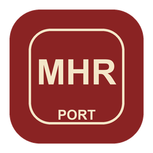

<p align="center"></p>

# Monster Hunter Rise — native Android port

Runs the Nintendo Switch version of **Monster Hunter Rise** natively on Android handhelds, from **your own copy** of the game.
It is not an emulator: the game's own ARM64 code runs directly on the device's CPU, while this project reimplements the
parts of the console it talks to.

> **Unofficial, non-commercial fan project.** Not affiliated with, endorsed or sponsored by Nintendo or Capcom. All
> trademarks belong to their owners. This repository contains **no game code, no game assets, no keys and no decryption
> or dumping tools**. To use it you need a copy of the game that you bought, with its files extracted on your own console.

## Status

**Release 1.0.0 — playable.** Kamura village and hunts run at a locked 30 fps: when a scene gets too heavy the
port lowers the game's internal resolution for a moment (dynamic resolution) instead of dropping frames. Upscaled to
1080p with AMD FSR 1. Sunbreak and the other DLC load if you provide them.

- First visits to new areas can hitch while shaders are compiled; it gets smoother as the shader cache fills up.
- Known issues: occasional speckles on the first loading screen after choosing a save; some effects may look wrong.

**Target device:** Retroid Pocket Flip 2 (Snapdragon 865 / Adreno 650, Android 13), where it was developed and tested.
The Retroid Pocket 5 has the same chip and should behave the same, but it has not been tested. Other Android devices are
not supported (the graphics code relies on Adreno 650 behaviour and its stock Vulkan driver).

## What you need

- **The game files of version 16.0.1**, already extracted on your own console, as plain folders:
  - **ExeFS** — the folder with `main`, `main.npdm`, `sdk`, … of the game *with update 16.0.1 applied*
    (the app checks the build ID of `main`: `55d50ca1805e9c5bba508d601add852f255a32ba`).
  - **RomFS** — the game's RomFS with the same update applied.
- **DLC (optional, e.g. Sunbreak):** the RomFS of each DLC you own, each in its own folder. Keep the DLC title ID in the
  folder name as your dumping tool wrote it (for example `... (0100B04011743001) ...`): that is how the app tells the DLC
  apart. Folders named `aoc/<index>` also work.
- Enough free space for the game plus about 1 GB for the shader cache and saves (internal storage or SD card).

The app **does not accept NSP, XCI or NCA files and does not decrypt anything**: if the files are encrypted it will tell
you and stop. This project does not explain how to dump or decrypt games and will not help with it. Please do not open
issues asking for game files, keys or how to obtain them.

## Install and first run

1. Download `mhriseport-vX.Y.Z.apk` from the [latest release](https://github.com/IamWilmar/mhrise-recomp/releases/latest) (or build
   it yourself, below) and install it on the device.
2. Copy your extracted game folders to the device, anywhere you like (for example one folder `MHRise` with the ExeFS
   and RomFS folders inside).
3. Open the app, grant *All files access*, browse to that folder with the touch screen or the d-pad and choose
   **Use this folder**. The app checks that the files are this game, the right version and not encrypted.
4. Press **Start game**. Next time the app goes straight to this screen.

Saves, the shader cache and `log.txt` are written into that same folder. The first time you visit each place the game
may stutter while its shaders are translated and compiled; they are cached for the next time.

## Options

Creating an empty file (or folder) with one of these names in the game folder changes how the port runs. They are read
at start-up.

| Name | Effect |
|---|---|
| `lsfg/` | Frame generation (Lossless Scaling's LSFG) to show ~60 fps. Needs **your own** `Lossless.dll` from the Windows app *Lossless Scaling* (sold on Steam), copied into that `lsfg` folder or to `Download/Lossless.dll`. Not included here. |
| `60fps` | Unlocks 60 fps mode (the Flip 2 GPU reaches ~45 in the village, less in hunts). |
| `registro` | Verbose log (line by line) plus a watchdog that prints the game's stack if it hangs. Slower: for debugging. |

## How it works

```
APK
├── SetupActivity (Java)   finds and checks the user's game files, then starts the native activity
└── NativeActivity
    ├── loader             maps main + subsdk* from the ExeFS, applies relocations, links imports,
    │                      patches the few instructions that cannot run on Android (svc, tpidrro_el0, counters)
    └── libnnsdk.so        reimplementation of the Switch SDK the game imports: nn::os (threads, sync, memory),
        │                  nn::fs (RomFS, saves), nn::hid (controller), audio (AAudio), codecs, …
        └── nvn/           the NVN graphics API on top of Vulkan; the game's Maxwell shaders are translated to
                           SPIR-V with Eden's shader recompiler, then cached
```

The SDK and NVN layers were written from scratch by observing what the game calls and with which values (there are no
SDK headers or Nintendo code in this repository); comments next to each deduced value give the evidence. Code comments
are mostly in Spanish.

## Building

Requirements (macOS or Linux): Android SDK with **NDK 28.2.13676358**, build-tools 35.0.0 and platform android-33; a JDK
(17 or newer); CMake ≥ 3.22; Python 3; git, curl and zip.

```bash
tools/setup.sh       # once: fetches the pinned third-party sources (Eden's shader recompiler, sirit, fmt, Boost…)
tools/build_apk.sh   # builds build/mhriseport.apk
adb install -r build/mhriseport.apk
```

`ANDROID_HOME` selects the SDK (default `~/Library/Android/sdk`). The APK is signed with the Android debug key unless you
pass `KEYSTORE=… KS_PASS=…`. For development, `tools/apk.sh` builds, installs, starts the game on the device connected by
adb and prints its log. The Python scripts in `tools/` are analysis helpers that work on your own extracted files in
`work/` (ignored by git).

## License

GPL-3.0-or-later (see [LICENSE](LICENSE)), because it builds on Eden's shader recompiler (GPL-3.0-or-later). Third-party
components and their licenses are listed in [THIRD_PARTY_NOTICES.md](THIRD_PARTY_NOTICES.md).

---

## En español

Port nativo para Android de la versión de Switch de **Monster Hunter Rise**. No es un emulador: el código ARM64 del juego corre
directo en la CPU y este proyecto reimplementa el SDK de la consola y la API gráfica NVN sobre Vulkan.

- **Necesitas tu propia copia del juego**, versión 16.0.1, con el ExeFS y la RomFS ya extraídos en tu consola, como
  carpetas normales. La app **no acepta NSP/XCI/NCA ni descifra nada**. Este repositorio no tiene código ni archivos del
  juego, ni claves, ni herramientas para volcar o descifrar.
- Descarga la APK de [Releases](https://github.com/IamWilmar/mhrise-recomp/releases/latest) e instálala. Copia esas carpetas al
  dispositivo, abre la app, dale el permiso de archivos, elige la carpeta y pulsa *Iniciar juego*.
  Las partidas y la caché de shaders se guardan en esa misma carpeta.
- Probado en la Retroid Pocket Flip 2. Proyecto de fans, sin ánimo de lucro, sin relación con Nintendo ni con
  Capcom.
